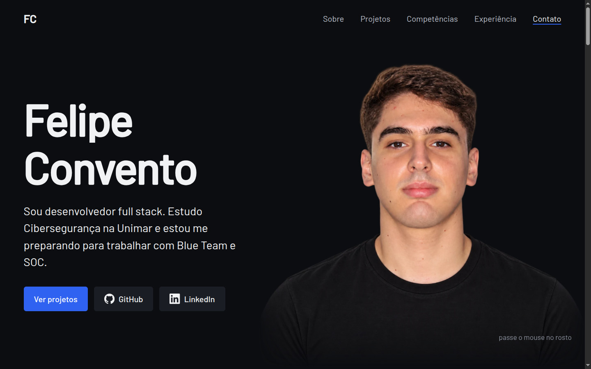

# Felipe Convento, portfólio

Site pessoal: https://felipe-convento.vercel.app

Sou desenvolvedor full stack e estudo Cibersegurança na Unimar. O site reúne meus projetos (PandaVIP, Mercadog, Keyhound e o laboratório de SOC), competências e formação.



## Como foi feito

- Angular 22 com prerender: o site é gerado como HTML estático e funciona sem servidor.
- O retrato da abertura revela uma versão robô sob o cursor. É um shader em Three.js que mistura duas imagens com o mesmo enquadramento, limitado à silhueta da foto.
- GSAP e Lenis nas animações de entrada e na rolagem; tudo é desligado quando o sistema pede movimento reduzido.
- Conteúdo em arquivos TypeScript em `frontend/src/app/content/`, fácil de editar sem mexer nos componentes.

## Segurança

- Content-Security-Policy com hash para cada script inline. O build falha se um script novo aparecer sem hash (`frontend/scripts/check-csp.mjs`).
- HSTS com preload, `X-Frame-Options: DENY`, `nosniff`, `Referrer-Policy` e `Permissions-Policy`, configurados em `frontend/vercel.json`.
- Sem cookies, analytics ou recursos de terceiros. Mais detalhes em `docs/site-security.md`.

## Rodar localmente

```bash
cd frontend
npm install
npm start        # http://localhost:4200
npm run build    # saída estática em dist/frontend/browser
```
